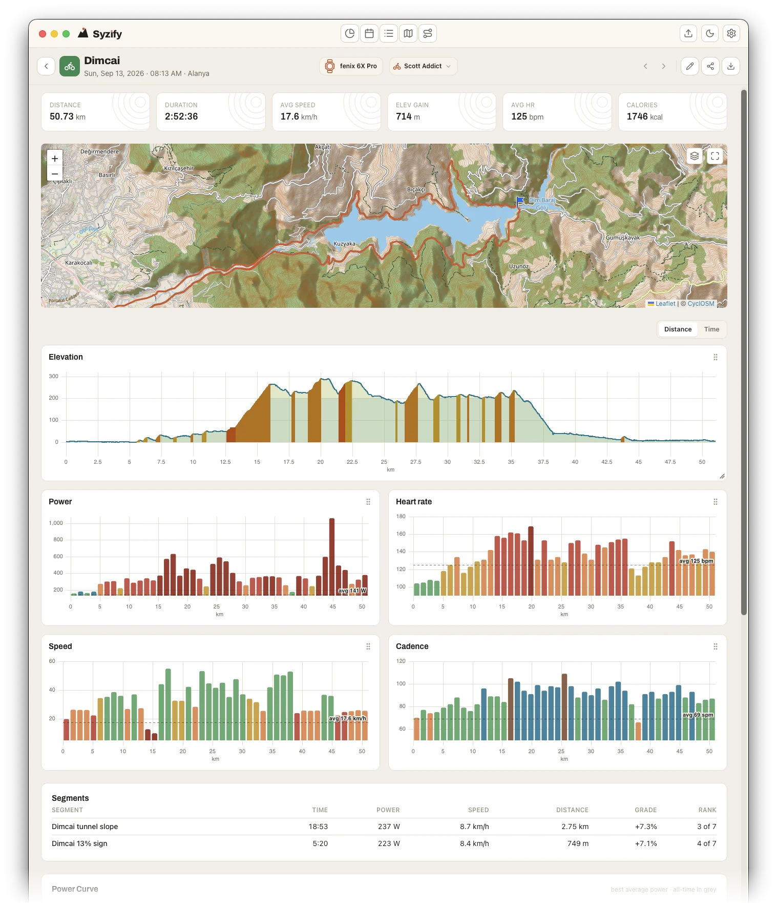

# Syzify

[](https://github.com/Stasyanz/syzify/actions/workflows/ci.yml)
[](https://github.com/Stasyanz/syzify/releases/latest)
[](https://codecov.io/gh/Stasyanz/syzify)
[](LICENSE)


**The encrypted, local-first training log for the desktop.** Syzify keeps your
workouts in a folder on your own disk and can encrypt it with one password.
No account, no server, no telemetry.

[Website](https://syzify.siliconbasement.com) ·
[Download](#install) ·
[Documentation](https://syzify.siliconbasement.com/docs/) ·
[Security model](https://syzify.siliconbasement.com/docs/security/) ·
[Changelog](CHANGELOG.md)

<p align="center">
  <picture>
    <source media="(prefers-color-scheme: dark)" srcset=".github/screenshots/activity-dark.webp">
    
  </picture>
</p>

## Why Syzify

- **Encrypted at rest.** One password encrypts the workout files, the database
  and the photos together, with AES-256-GCM and SQLCipher. A stolen laptop holds
  ciphertext, not your routes. The
  [security model](https://syzify.siliconbasement.com/docs/security/) spells out
  what this covers and what it doesn't.
- **An archive that outlives services.** Every imported file is kept
  byte-for-byte next to the parsed data. The whole vault backs up into one zip
  and restores on another machine, and any activity exports back to GPX.
- **A desktop app, not a server.** Native on macOS, Windows and Linux, and it
  works offline. Nothing to self-host and nothing to sign up for.

## Features

- **Import** GPX, FIT and TCX files, plain or gzipped, and full Runkeeper
  archives. Drop files or a folder onto the window, or let a watch folder pick
  them up. Duplicates are detected by content.
- **Every sport in one place.** Sports from different vendors normalize into one
  list, and multisport files import as a single triathlon with every leg counted.
- **Charts that know your zones.** Heart rate, power, cadence and speed are
  colored by the zones your device recorded, with time in zones, laps and a
  power curve alongside.
- **Maps.** A route for every activity and a world map of every start point,
  with five map styles and a local tile cache.
- **Records and trends.** Personal bests per sport and distance, a training
  calendar and weekly volume, all computed locally.
- **Share images** composed from your own photo inside the app. Nothing is
  uploaded anywhere.
- **Plugins** run in a WebAssembly sandbox, are signed, and get only the
  capabilities they declare. See [examples/plugins/](examples/plugins/README.md).

What goes over the network: map tiles, fetched from the map's provider and
cached on disk. Place names via OpenStreetMap are off by default, and updates
are checked only when you click.
[The full list](https://syzify.siliconbasement.com/docs/security/#network).

## Install

Download the latest release:

| Platform | ARM64 | x64 |
|---|---|---|
| macOS | [.dmg](https://github.com/Stasyanz/syzify/releases/latest/download/Syzify-macos-arm64.dmg) (Apple Silicon) | [.dmg](https://github.com/Stasyanz/syzify/releases/latest/download/Syzify-macos-x64.dmg) (Intel) |
| Windows | [setup.exe](https://github.com/Stasyanz/syzify/releases/latest/download/Syzify-windows-arm64-setup.exe) · [.msi](https://github.com/Stasyanz/syzify/releases/latest/download/Syzify-windows-arm64.msi) | [setup.exe](https://github.com/Stasyanz/syzify/releases/latest/download/Syzify-windows-x64-setup.exe) · [.msi](https://github.com/Stasyanz/syzify/releases/latest/download/Syzify-windows-x64.msi) |
| Linux | [.AppImage](https://github.com/Stasyanz/syzify/releases/latest/download/Syzify-linux-arm64.AppImage) · [.deb](https://github.com/Stasyanz/syzify/releases/latest/download/Syzify-linux-arm64.deb) | [.AppImage](https://github.com/Stasyanz/syzify/releases/latest/download/Syzify-linux-x64.AppImage) · [.deb](https://github.com/Stasyanz/syzify/releases/latest/download/Syzify-linux-x64.deb) |

Earlier versions are on
[GitHub Releases](https://github.com/Stasyanz/syzify/releases). The builds are
not signed with a paid vendor certificate yet, so each system asks once before
it lets the app run.

### macOS: Homebrew

```bash
brew install --cask stasyanz/syzify/syzify
```

This installs Syzify from the
[project's tap](https://github.com/Stasyanz/homebrew-syzify) and clears the
quarantine flag described below for you. If Syzify is already in Applications,
add `--adopt`. The app keeps updating itself, so `brew upgrade` leaves it alone
unless you pass `--greedy`.

### macOS: first launch

Without Homebrew, open the `.dmg` and drag Syzify into Applications. On the first launch
Gatekeeper may report that Syzify **“is damaged and can't be opened”**. The app
is not damaged: it is not notarized by Apple, and macOS refuses any such app
that arrived as a download. Clear the flag in Terminal and open the app again:

```bash
xattr -dr com.apple.quarantine /Applications/Syzify.app
```

The command removes one attribute, `com.apple.quarantine`, from the app bundle.
That is the mark macOS puts on downloaded files. It changes nothing else on
your system and is needed once per install.

### Windows: first launch

SmartScreen may show **“Windows protected your PC”** for the installer. Choose
**More info**, then **Run anyway**.

### Linux

Install the `.deb` with your package manager, or make the AppImage executable
and run it:

```bash
sudo apt install ./Syzify-linux-x64.deb
chmod +x Syzify-linux-x64.AppImage && ./Syzify-linux-x64.AppImage
```

### First steps

Drop your workout files onto the window, or click the import button in the
toolbar. The [documentation](https://syzify.siliconbasement.com/docs/) covers
importing, the vault, encryption and backups.

## Release notes and feedback

- Release notes by email: subscribe on the
  [website](https://syzify.siliconbasement.com/#download). New releases only.
- Bugs and ideas: [open an issue](https://github.com/Stasyanz/syzify/issues).

## Building from source

Syzify is built with Tauri 2, React and TypeScript.

### Prerequisites

- [Node.js](https://nodejs.org/) (v20+; CI uses 22)
- [Rust](https://www.rust-lang.org/tools/install) (stable)
- Tauri system dependencies (see below)

#### macOS

```bash
xcode-select --install
```

#### Linux (Debian/Ubuntu)

```bash
sudo apt update
sudo apt install libwebkit2gtk-4.1-dev build-essential curl wget file \
  libxdo-dev libssl-dev libayatana-appindicator3-dev librsvg2-dev
```

#### Windows

- [Microsoft Visual Studio C++ Build Tools](https://visualstudio.microsoft.com/visual-cpp-build-tools/)
- [WebView2](https://developer.microsoft.com/en-us/microsoft-edge/webview2/) (preinstalled on Windows 10/11)

### Development

```bash
npm install
npm run tauri dev
```

### Tests

```bash
npm test
```

### Build

#### macOS (.dmg, .app)

Two separate per-architecture builds (each DMG is smaller than a universal one):

```bash
npm run build:mac-arm     # Apple Silicon — tauri build --target aarch64-apple-darwin
npm run build:mac-intel   # Intel        — tauri build --target x86_64-apple-darwin
```

Each needs its Rust target installed (once):

```bash
rustup target add aarch64-apple-darwin x86_64-apple-darwin
```

Artifacts: `src-tauri/target/<triple>/release/bundle/dmg/` (Tauri names the files
`…_aarch64.dmg` and `…_x64.dmg`). A build for the current architecture without an
explicit target — `npm run tauri build` → `src-tauri/target/release/bundle/…`.

#### Linux (.deb, .AppImage)

x64 — the default on an x64 host:

```bash
npm run tauri build
```

ARM64 (aarch64) — natively on an ARM64 host:

```bash
rustup target add aarch64-unknown-linux-gnu
npm run build:linux-arm   # = tauri build --target aarch64-unknown-linux-gnu
```

Artifacts: `src-tauri/target/release/bundle/{deb,appimage}/` (for ARM64 — under
`src-tauri/target/aarch64-unknown-linux-gnu/release/bundle/`). Cross-compiling Linux
ARM from an x64 host is painful with Tauri (it needs ARM builds of webkit/gtk); building
on an ARM64 machine is simpler — CI uses a native ARM64 runner for this.

#### Windows (.msi, .exe)

x64 (Intel/AMD) — the default on an x64 host:

```bash
npm run tauri build
```

ARM64 (Windows on ARM, natively):

```bash
rustup target add aarch64-pc-windows-msvc
npm run build:win-arm   # = tauri build --target aarch64-pc-windows-msvc
```

Artifacts: `src-tauri/target/release/bundle/msi/` and `…/bundle/nsis/` (for ARM64 —
under `src-tauri/target/aarch64-pc-windows-msvc/release/bundle/`). The x64 binary also
runs on Windows on ARM through the built-in emulation; native ARM64 buys speed and
battery life.

### Recommended IDE Setup

- [VS Code](https://code.visualstudio.com/) + [Tauri](https://marketplace.visualstudio.com/items?itemName=tauri-apps.tauri-vscode) + [rust-analyzer](https://marketplace.visualstudio.com/items?itemName=rust-lang.rust-analyzer)

## CI (GitHub Actions)

Two workflows in `.github/workflows/`:

- **`ci.yml`** — on every push/PR to `main`: type-check (`tsc`), unit tests (`vitest`)
  and `cargo test` (installing Tauri's system dependencies on Linux).
- **`release.yml`** — on a `v*` tag: a build matrix (macOS Apple Silicon, macOS Intel,
  Linux x64, Linux ARM64, Windows x64, Windows ARM64), then a GitHub Release with the
  installers attached (`.dmg`/`.deb`/`.AppImage`/`.msi`/`.exe`). The Linux and Windows
  ARM64 targets build on native runners (`ubuntu-24.04-arm`, `windows-11-arm`) — free
  for public repositories; private ones need a paid plan / larger runners. The release
  is created only when all 6 targets build (a failed target — rerun the job).

Cutting a release: `scripts/release.sh <X.Y.Z>` → review the CHANGELOG → commit →
`git tag vX.Y.Z` → `git push origin main vX.Y.Z` triggers `release.yml`. Push the
tag explicitly — `git push --tags` would also publish any stale local tags.
Once the release is published, `scripts/update-cask.sh <X.Y.Z>` points the
[Homebrew cask](https://github.com/Stasyanz/homebrew-syzify) at it, using the
dmg digests GitHub computed on upload; commit and push the tap by hand.

## License

Syzify is distributed under the [GNU AGPL v3](LICENSE) with an additional
permission — the [Syzify Plugin Exception](LICENSE-PLUGIN-EXCEPTION.md):
plugins that interact with the application only through the official Plugin API
(manifest, host functions, ViewSpec — see
[examples/plugins/README.md](examples/plugins/README.md))
may be distributed under any license of the author's choosing, including a
commercial one.

The example plugins in [examples/plugins/](examples/plugins/) are licensed
under MIT-0 — feel free to copy them into your own plugin under any license.

```
Syzify — local-first workout viewer and journal
Copyright (C) 2026 Stanislav Zainullin

This program is free software: you can redistribute it and/or modify
it under the terms of the GNU Affero General Public License as
published by the Free Software Foundation, version 3.

This program is distributed in the hope that it will be useful,
but WITHOUT ANY WARRANTY; without even the implied warranty of
MERCHANTABILITY or FITNESS FOR A PARTICULAR PURPOSE.  See the
GNU Affero General Public License for more details.

You should have received a copy of the GNU Affero General Public
License along with this program.  If not, see <https://www.gnu.org/licenses/>.
```

The project is open source, but not open contribution (like SQLite):
pull requests are not accepted; bug reports and ideas in issues are
welcome. See [CONTRIBUTING.md](CONTRIBUTING.md) for details.
